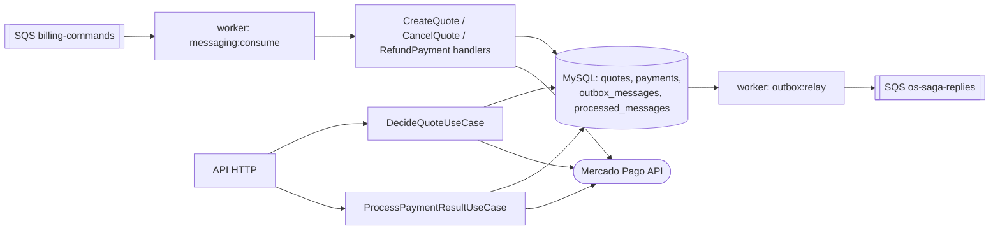

# billing-service — Orçamento e Pagamento

[](https://github.com/VinnyTechDevelopment/billing-service-fiap/actions/workflows/laravel-ci.yml)
[](https://sonarcloud.io/summary/new_code?id=VinnyTechDevelopment_billing-service-fiap)
[](https://sonarcloud.io/summary/new_code?id=VinnyTechDevelopment_billing-service-fiap)

Microsserviço de **orçamentos e pagamentos** da oficina (Tech Challenge FIAP, Fase 4). Participa da Saga de Ordem de Serviço orquestrada pelo [os-service](https://github.com/VinnyTechDevelopment/tech-challenge-fiap) e integra com o **Mercado Pago**.

| | |
|---|---|
| Stack | PHP 8.4, Laravel 13, arquitetura DDD (Domain / Application / Infrastructure / Presentation) |
| Banco | **MySQL próprio** (RDS `billing-<ambiente>`), sem acesso de nenhum outro serviço |
| Mensageria | Consome `billing-commands` (SQS); publica em `os-saga-replies` via **outbox transacional** |
| Pagamento | Mercado Pago Checkout Pro: preferência, webhook com validação `x-signature` e estorno |
| Deploy | EKS, namespace `billing` / `billing-homolog` (Terraform em [`infra/`](infra)) |
| Observabilidade | New Relic APM + distributed tracing (headers de trace propagados nas mensagens) |

## Responsabilidades

- **Geração do orçamento** a partir do comando `billing.CreateQuote` (snapshot de serviços/peças com preço), com **links de aprovação/recusa** que o os-service envia por e-mail ao cliente.
- **Aprovação pelo cliente:** cria o checkout no Mercado Pago e devolve o `payment_url` (`billing.QuoteApproved`).
- **Registro e verificação do pagamento:** o webhook do Mercado Pago é validado (`x-signature`) e o pagamento é sempre **reconsultado** na API do MP. Emite `billing.PaymentConfirmed` ou `billing.PaymentFailed`, e o os-service atualiza o status da OS.
- **Compensações da saga:** `billing.CancelQuote` (cancela orçamento e pagamento pendente) e `billing.RefundPayment` (estorno no MP, com idempotency key).
- **Pagamento atrasado:** se o pagamento é aprovado depois de a saga ter sido compensada (timeout/cancelamento), o billing **estorna automaticamente** e avisa (`late_payment`).

## Arquitetura do serviço



| Camada | Principais classes |
|---|---|
| Domain | `Quote` (pending_approval → approved → paid → refunded / rejected / cancelled), `Payment`, `PaymentGatewayInterface` |
| Application | `CreateQuoteHandler`, `CancelQuoteHandler`, `RefundPaymentHandler`, `DecideQuoteUseCase`, `ProcessPaymentResultUseCase` |
| Infrastructure | `MercadoPagoGateway` (REST), `MercadoPagoSignatureValidator`, `FakePaymentGateway`, repositórios Eloquent, mensageria (SQS, outbox, inbox idempotente) |
| Presentation | `QuoteDecisionController` (público), `MercadoPagoWebhookController`, `BillingController` (JWT de funcionário) |

## API

Contrato completo em [`openapi.yaml`](openapi.yaml).

| Método | Rota | Acesso |
|---|---|---|
| GET | `/api/billing/quotes/{token}/approve` | público (link do e-mail) |
| GET | `/api/billing/quotes/{token}/reject` | público |
| POST | `/api/billing/quotes/{token}/decision` | público |
| POST | `/api/billing/webhooks/mercadopago` | Mercado Pago (assinatura `x-signature`) |
| POST | `/api/billing/payments/{id}/simulate` | só com `PAYMENT_GATEWAY=fake` (demonstração) |
| GET | `/api/billing/service-orders/{osId}` | JWT de funcionário |
| GET | `/api/billing/payments/{id}` | JWT de funcionário |

## Mercado Pago

1. Crie uma aplicação em <https://www.mercadopago.com.br/developers/panel> e copie o **Access Token de teste** (`TEST-...`).
2. Em **Webhooks**, cadastre `https://<api-gateway>/api/billing/webhooks/mercadopago` (evento *Pagamentos*) e copie a **assinatura secreta**.
3. Configure os secrets `MERCADOPAGO_ACCESS_TOKEN` e `MERCADOPAGO_WEBHOOK_SECRET` (organização GitHub).
4. Em sandbox (`MERCADOPAGO_SANDBOX=true`) o link usado é o `sandbox_init_point`. Pague com os [cartões de teste](https://www.mercadopago.com.br/developers/pt/docs/checkout-pro/additional-content/your-integrations/test/cards).

Para demonstração sem o Mercado Pago use `PAYMENT_GATEWAY=fake`: o `payment_url` aponta para `POST /api/billing/payments/{id}/simulate` (`{"status": "approved" | "rejected"}`).

## Executando

```bash
cp .env.example .env
composer install && php artisan key:generate
php artisan migrate
php artisan serve --port=8084          # API
php artisan messaging:consume          # worker: comandos da saga
php artisan outbox:relay               # worker: publica o outbox no SQS
```

Para o ambiente completo (3 serviços + LocalStack), use o `docker-compose.microservices.yml` do [os-service](https://github.com/VinnyTechDevelopment/tech-challenge-fiap).

## Testes e cobertura

```bash
make test       # PHPUnit dentro da imagem
make coverage   # coverage.xml + gate de 80%
```

| | |
|---|---|
| Testes | 64 (unitários de domínio/gateway + integração da participação na saga, webhook e outbox) |
| **Cobertura de linhas** | **96,3%** (mínimo exigido no CI: 80%) |

O CI ([`laravel-ci.yml`](.github/workflows/laravel-ci.yml)) roda Pint → PHPUnit + gate de cobertura → SonarCloud (quality gate) → kubeconform → build da imagem. Em `main`, `build-ghcr.yml` publica a imagem e `deploy-eks.yml` aplica o Terraform: RDS, fila SQS + DLQ, Job de migration, Deployments da API (HPA + NLB) e do worker.

## Kubernetes

- Manifestos de referência: [`k8s/`](k8s) (validados no CI).
- Deploy real: [`infra/kubernetes.tf`](infra/kubernetes.tf). Os workers usam `args` (e não `command`) para preservar o ENTRYPOINT que injeta a License Key do New Relic.
